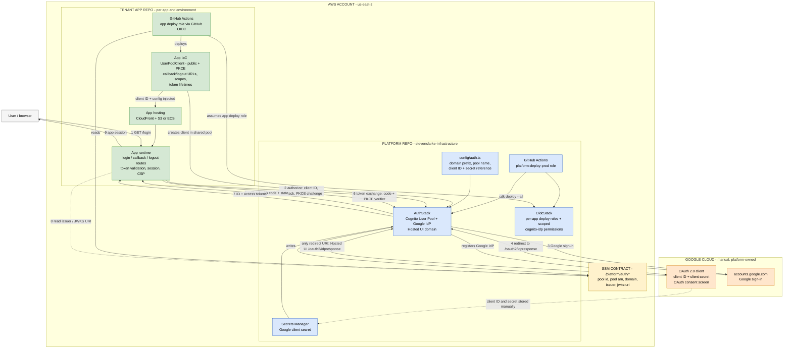
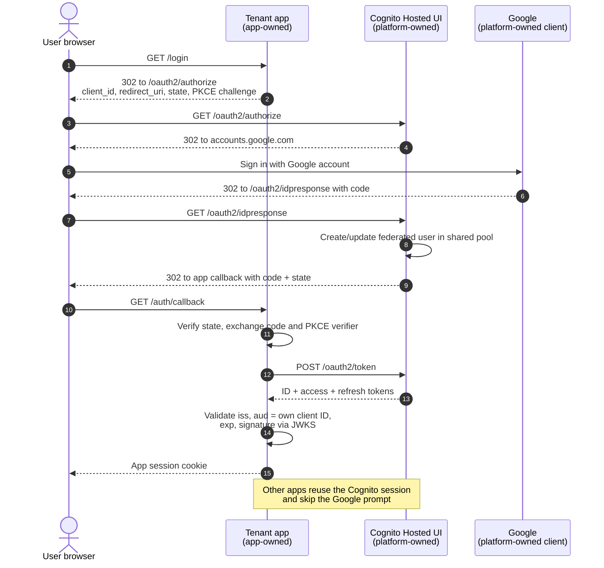

# Google SSO for Tenant Apps

Tenant applications on the `stevenclarke.dev` platform can offer "Sign in with Google"
without building their own identity provider or handling a Google client secret. This
document describes what the platform provides and what each application must implement.

> **Status:** this is the target design (Phase 10 in [plan.md](../plan.md)). The shared
> Cognito user pool, Google identity provider, and `/platform/auth/*` SSM parameters are
> not deployed yet. Treat this document as the integration contract to build against;
> the links and examples will be verified when the platform stack is deployed.

## What the platform provides

| Concern | Owner |
| --- | --- |
| Google Cloud OAuth client, consent screen, client secret | Platform (manual setup + Secrets Manager) |
| Cognito User Pool and Google federated identity provider | Platform (`AuthStack`) |
| Cognito Hosted UI domain (`<prefix>.auth.us-east-2.amazoncognito.com`) | Platform |
| `/platform/auth/*` SSM parameters | Platform |
| Scoped `cognito-idp` client-management permissions on app deploy roles | Platform (`OidcStack`) |
| Per-app OAuth client (callback URLs, logout URLs, scopes, token lifetimes) | **Application** |
| Sign-in UI, callback/logout routes, session handling, token validation, CSP | **Application** |

One user pool is shared by every tenant app and both `preview` and `prod`. A single
Cognito Hosted UI session therefore gives SSO across all apps: sign in once with Google
and other apps in the pool do not prompt again until the session expires. Each app still
has its own OAuth client, so an app cannot request tokens for another app's client ID.

The platform owns the only Google OAuth client. Its single registered redirect URI is
`https://<auth-domain>/oauth2/idpresponse`, so adding or changing tenant apps never
requires a Google Cloud Console change. The Google client secret never leaves platform
Secrets Manager; apps use public clients with PKCE and hold no secret at all.

## Architecture



**Where each piece is implemented**

| Piece | Location |
| --- | --- |
| Google OAuth client, consent screen, redirect URI | Google Cloud Console (manual, platform-owned) |
| Google client secret | AWS Secrets Manager (platform-owned secret) |
| User pool, Google IdP, Hosted UI domain, SSM values | `lib/auth-stack.ts` + `config/auth.ts`, wired in `bin/app.ts` |
| App deploy role `cognito-idp` permissions | `lib/oidc-stack.ts` (platform) |
| `/platform/auth/*` SSM contract | Published by `AuthStack`, consumed by app IaC and app code |
| OAuth client, callback/logout URLs, scopes, lifetimes | Tenant app repo (`UserPoolClient` in CDK or `aws_cognito_user_pool_client` in Terraform) |
| Login/callback/logout routes, token validation, session, CSP | Tenant app code |
| App hosting | Tenant app repo (CloudFront + S3 or ECS) |

## SSM contract (all parameters in `us-east-2`)

| Parameter | Value / purpose |
| --- | --- |
| `/platform/auth/user-pool-id` | Shared Cognito user pool ID; import the pool to create your client |
| `/platform/auth/user-pool-arn` | Pool ARN; used for IAM scoping and Cognito authorizers |
| `/platform/auth/domain` | Hosted UI domain, e.g. `stevenclarke.auth.us-east-2.amazoncognito.com` |
| `/platform/auth/issuer` | `https://cognito-idp.us-east-2.amazonaws.com/<user-pool-id>` |
| `/platform/auth/jwks-uri` | `https://cognito-idp.us-east-2.amazonaws.com/<user-pool-id>/.well-known/jwks.json` |

Always read the domain and issuer from SSM. Do not hardcode them: the platform may change
the domain prefix or move to a custom domain such as `auth.stevenclarke.dev` without
requiring app changes.

The app deploy role already has `ssm:GetParameter`/`ssm:GetParameters`, so reading these
values needs no extra permission.

## Sign-in flow



1. Your app sends the user to
   `https://<auth-domain>/oauth2/authorize` with `response_type=code`, your `client_id`,
   your exact `redirect_uri`, `scope=openid email profile`, a random `state`, and a PKCE
   `code_challenge` (`S256`). Add `identity_provider=Google` to skip provider selection.
2. Cognito redirects to Google. The user signs in with a Google account. Google redirects
   back to the Cognito `/oauth2/idpresponse` endpoint (the platform's registered URI).
3. Cognito creates or updates the federated user and redirects to your `callback_url`
   with `code` and `state`.
4. Your callback verifies `state`, then POSTs the code, `client_id`, `redirect_uri`, and
   `code_verifier` to `https://<auth-domain>/oauth2/token`.
5. Validate the returned ID token (see below), create your app session, and redirect to
   the protected page.
6. Sign out by clearing your app session and redirecting to
   `https://<auth-domain>/logout?client_id=<client-id>&logout_uri=<your-logout-url>`.

## What your app must implement

### 1. Create one OAuth client per environment

Use a **public** client (no client secret) with authorization code + PKCE. Register the
exact callback and logout URLs for that environment.

**CDK (TypeScript):**

```ts
import * as cdk from 'aws-cdk-lib';
import * as cognito from 'aws-cdk-lib/aws-cognito';
import * as ssm from 'aws-cdk-lib/aws-ssm';

const userPoolId = ssm.StringParameter.valueForStringParameter(
  this,
  '/platform/auth/user-pool-id',
);
const userPool = cognito.UserPool.fromUserPoolId(this, 'SharedUserPool', userPoolId);

const isProd = props.environment === 'prod';
const host = isProd ? 'my-app.stevenclarke.dev' : 'my-app-preview.stevenclarke.dev';

new cognito.UserPoolClient(this, 'GoogleSignInClient', {
  userPool,
  userPoolClientName: `my-app-${props.environment}`,
  generateSecret: false,
  preventUserExistenceErrors: true,
  authFlows: {
    adminUserPassword: false,
    custom: false,
    userPassword: false,
    userSrp: false,
  },
  supportedIdentityProviders: [cognito.UserPoolClientIdentityProvider.GOOGLE],
  oAuth: {
    flows: {
      authorizationCodeGrant: true,
      implicitCodeGrant: false,
      clientCredentials: false,
    },
    scopes: [
      cognito.OAuthScope.OPENID,
      cognito.OAuthScope.EMAIL,
      cognito.OAuthScope.PROFILE,
    ],
    callbackUrls: [`https://${host}/auth/callback`],
    logoutUrls: [`https://${host}/`],
  },
  accessTokenValidity: cdk.Duration.hours(1),
  idTokenValidity: cdk.Duration.hours(1),
  refreshTokenValidity: cdk.Duration.days(30),
});
```

**Terraform:**

```hcl
data "aws_ssm_parameter" "user_pool_id" {
  name = "/platform/auth/user-pool-id"
}

locals {
  host = var.environment == "prod" ? "my-app.stevenclarke.dev" : "my-app-preview.stevenclarke.dev"
}

resource "aws_cognito_user_pool_client" "google_sign_in" {
  name         = "my-app-${var.environment}"
  user_pool_id = data.aws_ssm_parameter.user_pool_id.value

  generate_secret               = false
  prevent_user_existence_errors = "ENABLED"

  allowed_oauth_flows_user_pool_client = true
  allowed_oauth_flows                  = ["code"]
  allowed_oauth_scopes                 = ["openid", "email", "profile"]
  callback_urls                        = ["https://${local.host}/auth/callback"]
  logout_urls                          = ["https://${local.host}/"]
  supported_identity_providers         = ["Google"]
  explicit_auth_flows                  = []

  access_token_validity  = 60
  id_token_validity      = 60
  refresh_token_validity = 30

  token_validity_units {
    access_token  = "minutes"
    id_token      = "minutes"
    refresh_token = "days"
  }
}
```

A single client listing both preview and prod callback URLs also works, but separate
clients per environment give cleaner isolation and independent token lifetimes.

Your deploy role needs `cognito-idp:CreateUserPoolClient`, `UpdateUserPoolClient`,
`DeleteUserPoolClient`, `DescribeUserPoolClient`, `ListUserPoolClients`, and
`DescribeUserPool` scoped to the shared pool ARN. The platform grants these in Phase 10;
if they are missing, raise an issue in `stevenclarke-infrastructure` rather than
broadening the role yourself.

### 2. Configure runtime values

Read the issuer/domain from SSM at deploy time and inject them into the app:

```bash
DOMAIN=$(aws ssm get-parameter --name /platform/auth/domain --region us-east-2 \
  --query Parameter.Value --output text)
ISSUER=$(aws ssm get-parameter --name /platform/auth/issuer --region us-east-2 \
  --query Parameter.Value --output text)
```

Feed the resulting domain, issuer, your client ID, and your callback URL into your OIDC
library or framework auth provider (for example NextAuth's Cognito provider,
`oidc-client-ts`, or AWS Amplify). If you publish your client ID to SSM, use your own
namespace, e.g. `/app/<app>/<env>/auth-client-id`; that is application-owned.

### 3. Implement the OIDC routes

- `/login` (or a sign-in button): generate `state` and PKCE `code_verifier`, store both in
  an HttpOnly/Secure/SameSite cookie, then redirect to `/oauth2/authorize`.
- `/auth/callback`: check `state` matches the cookie, exchange the code with the
  `code_verifier` at `/oauth2/token`, validate the ID token, establish your session, and
  redirect to the originally requested page.
- `/logout`: clear your session cookie and redirect to `/logout` on the Cognito domain
  with `client_id` and `logout_uri`.
- Silent renewal: the shared Cognito session allows re-authentication via a prompt-free
  authorize request; keep refresh tokens in HttpOnly cookies, never in localStorage.

### 4. Validate tokens

For every protected route or API:

- Verify the RS256 signature using keys from `/platform/auth/jwks-uri`; cache keys and
  handle key rotation.
- Check `iss` equals `/platform/auth/issuer`.
- Check `aud` equals **your** client ID (ID token); for access tokens check the
  `client_id` claim instead.
- Check `exp` / `nbf` and `token_use` (`id` for ID tokens, `access` for access tokens).
- Only rely on `email` after checking `email_verified`.

For an API Gateway HTTP API, an alternative is a JWT authorizer configured with the
shared issuer/JWKS and your client ID as the audience. That resource stays in the app
repository.

### 5. Update Content Security Policy

Redirects are not blocked by CSP, but token requests and Google-hosted avatars are:

```text
default-src 'self';
connect-src 'self' https://<auth-domain>;
form-action 'self' https://<auth-domain> https://accounts.google.com;
img-src 'self' data: https://*.googleusercontent.com;
```

Allow only the domains your flow actually uses. Do not add `unsafe-inline` just to make
auth work.

### 6. Preview vs prod

Each environment has its own client and callback URLs under
`<app>-preview.stevenclarke.dev` / `<app>.stevenclarke.dev`. Both point at the same shared
user pool. Preview sign-ins create real federated users in that pool; that is acceptable
for the current single-account model. If hard isolation is ever required, the platform
must introduce a second user pool first.

## Testing checklist

- [ ] Sign in with a Google account from prod and preview; confirm the callback URL
      exactly matches the client configuration.
- [ ] Confirm a second app redirects without a Google prompt while the Cognito session
      is active, and prompts after sign-out.
- [ ] Confirm `state` mismatch is rejected and PKCE verifier is required.
- [ ] Confirm tokens with the wrong `iss` or a different `aud` are rejected.
- [ ] Confirm sign-out invalidates your app session and the Cognito session.
- [ ] Confirm CSP does not block `/oauth2/token` or avatar images.
- [ ] Confirm no Google client secret or ID token is written to localStorage, logs, or
      client-side source.

## Troubleshooting

| Symptom | Likely cause |
| --- | --- |
| `invalid_request` / redirect URI mismatch at Cognito | Callback URL in the authorize request differs from the client's configured `callbackUrls`, including trailing slash and scheme. |
| `redirect_uri_mismatch` from Google | Google's OAuth client redirect URI must be the platform-managed `https://<auth-domain>/oauth2/idpresponse`; apps must not register their own Google client. |
| `Unsupported identity provider` | The Google IdP is not attached to the shared user pool (platform-side issue). |
| `invalid_request` on sign-out | Cognito Hosted UI uses `logout_uri`, not `redirect_uri`. |
| `401 Unauthorized` from your API | Wrong issuer, wrong audience (must be your client ID), or stale JWKS cache. |
| CORS error calling `/oauth2/token` | Token exchange belongs in your backend or a correctly configured OIDC library; do not call it from arbitrary browser origins. |

## Do not

- Create your own Cognito user pool or your own Google Cloud OAuth client.
- Store a Google client secret in an app repository or ship it to the browser.
- Use the implicit flow or client credentials flow for user sign-in.
- Hardcode the Cognito domain or issuer; read them from `/platform/auth/*`.
- Grant another app's client ID access to your callback URLs.
